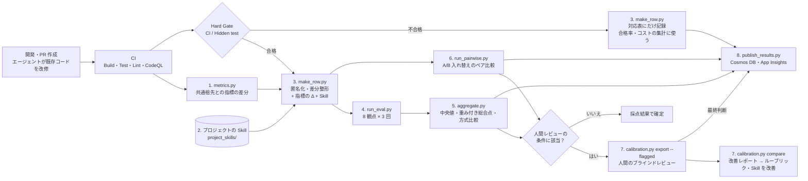

# コーディングエージェント PR の LLM Judge

コーディングエージェントが既存コードを改修した PR を、Microsoft Foundry に登録した評価器（LLM Judge）で採点し、**方式どうし（例: 固定モデルと HydraFusion）の品質・合格率・コストを方式名を伏せた同じ条件で比較する**ためのキットです。CI で品質の土台を担保し、機械的に測れる指標の差分とプロジェクトの Skill（ルール）を Judge に渡して改修の「質」を評価します。迷うケースだけを人間のブラインドレビューに回し、結果は Azure の可視化基盤に集めます。

採点・集計・比較の本体は Python のスクリプト（[scripts/](scripts/)）で、同じものを 3 つの形で実行できます（「[実行のしかた](#実行のしかた)」）。まず動かしてみる場合は「[クイックスタート](#クイックスタート)」、検証実験の結果は「[検証実験](docs/experiments.md)」を参照してください。

## 全体の流れ



図の番号は「[使い方（コマンドライン）](docs/usage.md)」の手順の番号です。GitHub Actions と評価サービスは、この流れの 3〜8 を自動で行います。

役割分担は次のとおりです。

| 評価項目 | CI | LLM Judge |
|---|---|---|
| 動くか（Build・Test） | ✅ ここで判定 | ❌ 判定させない |
| 既知パターンのセキュリティ | ✅ CodeQL | △ CI が見逃した重大問題のみ |
| 要件をすべて満たしているか | △ テストで書けた分だけ | ✅ 要件ごとに判定 |
| 設計・保守性・テストの質 | ❌ | ✅ |
| 不要な変更がないか | △ 行数だけ | ✅ 必要性を判定 |
| 複雑度・重複・結合度・波及しやすさ・モジュール性 | ✅ `metrics.py` で共通祖先との差分を計算 | △ 差分（Δ）を手がかりに、問題かどうかを判定 |
| プロジェクトのルールを守っているか | △ Lint で書けた分だけ | ✅ Skill に明記されたルールで判定 |
| PR 説明が妥当か | ❌ | ✅ |

## 実行のしかた

| 形態 | 向いている場面 | 自動になる範囲 | 説明 |
|---|---|---|---|
| コマンドライン | 試す・検証実験・答え合わせ | なし（各スクリプトを順に実行する） | [使い方（コマンドライン）](docs/usage.md) |
| GitHub Actions | 評価対象のリポジトリ 1 つで、CI に組み込む | PR ごとの採点、タスクごとの方式比較、人間レビューの Issue 作成 | [GitHub Actions](docs/github-actions.md) |
| Foundry Hosted Agent（評価サービス） | 複数のリポジトリ・CI で同じ評価基準を使う、モデル更新時に同じ条件で再評価する | 上に加え、実験 ID 単位の評価条件の固定、タスクをまたいだ比較、人間の判断の取り込み、中断からの復旧 | [Foundry Hosted Agent](docs/hosted-service.md) |

どの形態でも、評価器・指標・集計・人間レビューの条件（「[評価の設計](docs/evaluation-design.md)」）は同じです。GitHub Actions と評価サービスはテンプレート・コードの段階で、Azure へのデプロイと実行はまだしていません。

## 前提とセットアップ

### 前提

- Foundry プロジェクト: `Foundry-Claude-tniita/proj-default`（変更は環境変数 `AZURE_AI_PROJECT_ENDPOINT`）
- Judge: `gpt-6.1-sol`（モデルバージョン `2026-09-29` で固定チェック）。評価対象（Claude 系）と別系統にして自己選好バイアスを避けている。モデルを内部で選ぶ方式（HydraFusion・Copilot Fusion など）は Judge と同系統のモデルを使うことがあるため、使ったモデルを `make_row.py --agent-models` で記録すると、同系統の側を優位とした判定を人間レビューに回す。別系統の Judge では `JUDGE_DEPLOYMENT` / `JUDGE_MODEL_VERSION` を切り替えて採点し直す（「[評価の設計](docs/evaluation-design.md#評価の信頼性を保つ仕組み)」）
- 実行ユーザーにプロジェクトの **Azure AI User** 以上のロール
- `az login` 済みで、アクティブなサブスクリプションがプロジェクトと同じテナントにあること

> Foundry の MCP ツール（`evaluator_catalog_*` など）はこのテナントではトークンのテナント不一致で失敗するため、すべて SDK 経由で呼んでいます。資格情報は既定で Azure CLI のもの（`LLM_JUDGE_AUTH=cli`）を使い、評価サービス（Hosted Agent）ではマネージド ID（`default`）を使います（[scripts/azure_auth.py](scripts/azure_auth.py)）。

### セットアップ

```bash
az account set --subscription <subscription-id>   # Foundry プロジェクトのサブスクリプション
uv venv --python 3.12 .venv
uv pip install --python .venv/bin/python -r requirements.txt   # radon（指標計算）と azure-cosmos（結果の送信）を含む

# 評価器を Foundry の評価器カタログに登録（プロンプトに変更があるものだけ新バージョンを作る）
.venv/bin/python scripts/register_evaluators.py
```

以降のコマンドはすべてリポジトリのルートから実行します。

> **Windows（PowerShell）の場合:** `.venv/bin/python` を `.venv\Scripts\python.exe` に、`export NAME=value` を `$env:NAME = "value"` に読み替えてください。行末の `\` による改行は PowerShell ではバッククォート（`` ` ``）です。

### クイックスタート

セットアップ後、欠陥を仕込んだサンプル（[カナリア](docs/evaluation-design.md#カナリアjudge-の検出力チェック)）で一連の流れを確認できます。評価対象のリポジトリは不要です。

```bash
.venv/bin/python scripts/check_canaries.py build                     # カナリアの評価データを作る
.venv/bin/python scripts/run_eval.py datasets/canaries/canary_runs.jsonl --repeats 3 --name canary
.venv/bin/python scripts/check_canaries.py check results/<eval_id>   # 期待した判定になったかを確認
```

`<eval_id>` は `run_eval.py` の出力に表示されます。自分のリポジトリで評価するときは、「[使い方（コマンドライン）](docs/usage.md)」の 1〜5 を順に実行します。

## ドキュメント

| 文書 | 内容 |
|---|---|
| [使い方（コマンドライン）](docs/usage.md) | 指標の計算・評価データの作成・絶対評価・集計・ペア比較・人間との答え合わせ・可視化基盤への送信 |
| [評価の設計](docs/evaluation-design.md) | 評価器と入力、人間レビューに回す条件、評価の信頼性を保つ仕組み、カナリア |
| [GitHub Actions](docs/github-actions.md) | Run ごとの評価と、タスクごとの方式比較のワークフロー |
| [Foundry Hosted Agent（評価サービス）](docs/hosted-service.md) | 実験 ID 単位の評価サービスの操作・デプロイ・ローカル実行 |
| [可視化基盤（Azure）](docs/infrastructure.md) | Cosmos DB・Application Insights・Workbook・APIM の構成とデプロイ |
| [検証実験](docs/experiments.md) | 10 タスク × 2 方式の検証結果と、人間による答え合わせの手順 |
| [開発](docs/development.md) | 回帰テストとファイル構成 |
| [制約と注意点](docs/limitations.md) | まだ実証できていないこと、コスト、既知の制約 |
