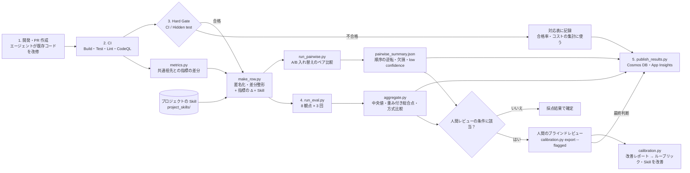

# コーディングエージェント PR の LLM Judge

コーディングエージェントが既存コードを改修した PR を、Microsoft Foundry に登録した評価器（LLM Judge）で採点し、**方式どうし（例: 固定モデルと HydraFusion）の品質・合格率・コストを方式名を伏せた同じ条件で比較する**ためのキットです。CI で品質の土台を担保し、機械的に測れる指標の差分とプロジェクトの Skill（ルール）を Judge に渡して改修の「質」を評価します。迷うケースだけを人間のブラインドレビューに回し、結果は Azure の可視化基盤に集めます。

まず動かしてみる場合は「[クイックスタート](#クイックスタート)」、検証実験の結果は「[検証実験](#検証実験experiments)」を参照してください。
## 全体の流れ



役割分担は次のとおりです。

| 評価項目 | CI | LLM Judge |
|---|---|---|
| 動くか（Build・Test） | ✅ ここで判定 | ❌ 判定させない |
| 既知パターンのセキュリティ | ✅ CodeQL | △ CI が見逃した重大問題のみ |
| 要件をすべて満たしているか | △ テストで書けた分だけ | ✅ 要件ごとに判定 |
| 設計・保守性・テストの質 | ❌ | ✅ |
| 不要な変更がないか | △ 行数だけ | ✅ 必要性を判定 |
| 複雑度・重複・結合度・波及しやすさ・モジュール性 | ✅ `metrics.py` で共通祖先との差分を計算 | △ 差分（Δ）を手がかりに、問題かどうかを判定 |
| プロジェクトのルールを守っているか | △ Lint で書けた分だけ | ✅ Skill に明記されたルールで判定 |
| PR 説明が妥当か | ❌ | ✅ |

## 前提

- Foundry プロジェクト: `Foundry-Claude-tniita/proj-default`（変更は環境変数 `AZURE_AI_PROJECT_ENDPOINT`）
- Judge: `gpt-6.1-sol`（モデルバージョン `2026-09-29` で固定チェック）。評価対象（Claude 系）と別系統にして自己選好バイアスを避けている
- 実行ユーザーにプロジェクトの **Azure AI User** 以上のロール
- `az login` 済みで、アクティブなサブスクリプションがプロジェクトと同じテナントにあること

> Foundry の MCP ツール（`evaluator_catalog_*` など）はこのテナントではトークンのテナント不一致で失敗するため、すべて SDK（`AzureCliCredential`）経由で呼んでいます。

## セットアップ

```bash
az account set --subscription <subscription-id>   # Foundry プロジェクトのサブスクリプション
uv venv --python 3.12 .venv
uv pip install --python .venv/bin/python -r requirements.txt   # radon（指標計算）と azure-cosmos（結果の送信）を含む

# 評価器を Foundry の評価器カタログに登録（プロンプトに変更があるものだけ新バージョンを作る）
.venv/bin/python scripts/register_evaluators.py
```

以降のコマンドはすべてリポジトリのルートから実行します。

> **Windows（PowerShell）の場合:** `.venv/bin/python` を `.venv\Scripts\python.exe` に、`export NAME=value` を `$env:NAME = "value"` に読み替えてください。行末の `\` による改行は PowerShell ではバッククォート（`` ` ``）です。

## クイックスタート

セットアップ後、欠陥を仕込んだサンプル（[カナリア](#カナリアjudge-の検出力チェック)）で一連の流れを確認できます。評価対象のリポジトリは不要です。

```bash
.venv/bin/python scripts/check_canaries.py build                     # カナリアの評価データを作る
.venv/bin/python scripts/run_eval.py datasets/canaries/canary_runs.jsonl --repeats 3 --name canary
.venv/bin/python scripts/check_canaries.py check results/<eval_id>   # 期待した判定になったかを確認
```

`<eval_id>` は `run_eval.py` の出力に表示されます。自分のリポジトリで評価するときは、次の「使い方」の 1〜5 を順に実行します。

## 使い方

### 1. 機械的な品質指標を計算する

`base` と `head` の共通祖先（merge-base）を改修前として、`head` との差分を `metrics.json` に出力します。PR 差分と同じ比較範囲なので、base ブランチだけに追加された変更は混ざりません。対象は Python で、テストコードは除外します。

```bash
.venv/bin/python scripts/metrics.py --repo ../target-repo --base main --head agent-branch --out metrics.json
```

| 指標 | 定義 | 差分 |
|---|---|---|
| 循環的複雑度（McCabe） | 制御フローの複雑さ（radon）。ネストした関数・クラスのメソッド・async 関数も含む全関数の合計 | ΔV（スコープ付きの関数名で増減を一覧） |
| 重複コード | 空白を正規化した 6 行単位で、2 か所以上に現れる行 | 重複行数・重複率の差（新たな重複箇所も一覧） |
| 結合度 | パッケージ内の import グラフでの Ce（依存する数）・Ca（依存される数）・I = Ce/(Ca+Ce) | ΔCe・ΔCa・ΔI（変わったモジュールごと） |
| 変更の波及しやすさ | Propagation Cost（到達可能性行列の密度） | ΔPC |
| モジュール性 | パッケージ（ディレクトリ）単位の分割に対する Newman のモジュラリティ Q | ΔQ |

ファイルごとの解析結果は git の blob SHA をキーに `--cache-dir`（既定 `.metrics-cache/`）に保存します。**ベースコミットの解析結果はキャッシュから取得され、今回の変更で中身が変わったファイルだけが再計算されます。** 除外したいパスは `--exclude 'vendor/*'` のように追加します。

同じスコープに同名の定義（property の getter/setter など）がある場合は、1 件にまとめて差分を出します（出現順で区別すると、間に定義を足しただけで別の関数と対応づくため）。解析器のバージョンが変わると旧キャッシュは削除します。`--prune-cache` を付けると今回の base / head で使わなかった解析結果も削除します（CI ではキャッシュが増え続けないよう付けています）。改修前・改修後のどちらかに構文エラーがある場合は `status: unavailable` と両側のエラーを記録し、指標の差分を `null` にします。計測不能を「改善」と扱わず、人間レビュー対象にして方式ごとの指標平均から除外します。過去の `metrics.json` は自動更新しないため、修正版で再計算してください。

### 2. プロジェクトの Skill を用意する

[project_skills/](project_skills/) のテンプレート（コーディング規約・用語集・アーキテクチャ・ADR・ライブラリ・制約）を評価対象リポジトリに合わせて書き換えます。**評価対象のエージェントと Judge に同じ Skill を渡します。** Judge は Skill に明記されたルールへの違反だけを指摘し、書かれていない好みでは減点しません。

### 3. データを作る

Run ごとに [scripts/make_row.py](scripts/make_row.py) を実行します。Judge に渡す評価データ（`datasets/runs.jsonl`）と、Judge に渡さない対応表（`datasets/manifest.jsonl`）に 1 行ずつ追記されます。

```bash
# リポジトリから差分を取る（周辺コードも見せるため前後 30 行付き）
.venv/bin/python scripts/make_row.py \
  --run-id r-8f3a --task-id T002 --variant fixed --attempt 1 --hard-gate pass \
  --task task.md --repo ../target-repo --base main --head agent-branch \
  --ci ci.txt --pr pr.md --metrics metrics.json --skills project_skills/ \
  --tokens-in 120000 --tokens-out 8000 --cost-usd 0.4 --duration-sec 210

# Hard Gate に落ちた Run は対応表にだけ記録する
.venv/bin/python scripts/make_row.py --run-id r-91c2 --task-id T002 --variant hydrafusion \
  --attempt 1 --hard-gate fail --cost-usd 0.7 --duration-sec 260
```

| 引数 | 内容 |
|---|---|
| `--run-id` | 推測できない ID。モデル名や方式名を含めない |
| `--variant` / `--attempt` | 方式名と、同じタスクでの何回目の生成か。対応表にだけ記録される |
| `--task` | 要件と完了条件。`R1:`、`R2:` のように ID を振ると、要件ごとの判定を集計できる |
| `--diff` または `--repo --base --head` | 変更差分 |
| `--context` | 差分に含まれない関連コード（呼び出し元など）。任意 |
| `--ci` | テストの Pass/Fail、Lint 件数、CodeQL の指摘の要約。Hidden test の結果もここに含める |
| `--pr` | PR 説明 |
| `--metrics` | `metrics.py` の出力。Judge には差分・主要な変化箇所（または計測不能の理由）、対応表には数値と計測状態を記録する。リポジトリ指定時は比較 SHA、`--diff` 指定時は変更された Python ファイルの一致を検証する |
| `--metrics-error` | `metrics.py` が失敗したときの理由。指標は計測不能として記録し、人間レビューに回す（`--metrics` とは併用不可） |
| `--skills` | プロジェクトの Skill（Markdown のディレクトリまたはファイル）。`README.md` と HTML コメントは除く。`--max-skills-chars`（既定 40,000 文字）で切り詰める |
| `--tokens-in` ほか | Run 全体の入力・出力トークン数、コスト、所要時間。実行基盤で集計した usage を入れる。未計測なら省略（0 にしない） |

`make_row.py` は次の処理を自動で行います。

- **匿名化:** `Co-authored-by` / `Generated with` などの行を削除し、モデル名・ベンダー名・方式名を `[REDACTED]` に置き換える。コード中の SDK 名まで伏せたくない場合は `--no-redact-diff`
- **差分の整形:** ロックファイルや `dist/` などの自動生成物を除外。`--max-diff-chars`（既定 150,000 文字）を超えるファイルは省略し、省略したことを Judge に伝える

### 4. 絶対評価

```bash
.venv/bin/python scripts/run_eval.py datasets/runs.jsonl --repeats 3 --name my-eval
```

8 つの評価器で 3 回ずつ採点し、`results/<eval_id>/` に保存します。最後に表示される `portal:` の URL から Foundry ポータルで結果を一覧できます。

### 5. 集計

```bash
.venv/bin/python scripts/aggregate.py results/<eval_id> datasets/manifest.jsonl --gap 5
```

| 出力 | 内容 |
|---|---|
| Run ごと | 観点別の中央値、重み付き総合点（0〜100）、要件の充足率、confidence、人間レビューの要否と理由 |
| 方式ごと | Hard Gate 合格率、平均総合点、要件の充足率、重大問題の発生率、1 試行あたりのコスト・トークン・所要時間（不合格の試行も含む）、指標の差分の平均 |
| 方式どうしの比較 | タスク単位の勝敗、総合点差の平均、符号検定の p 値。片方しか合格しなかったタスクは合格した方の勝ち |

結果は `summary.jsonl`（Run ごと）と `variants.json`（方式ごと・比較）にも保存されます。

### 6. ペア比較

```bash
.venv/bin/python scripts/run_pairwise.py datasets/runs.jsonl datasets/manifest.jsonl --name my-pairwise
```

同じタスクの 2 方式の PR を並べて「どちらをマージすべきか」を判定させます。位置バイアスを打ち消すため、**A/B を入れ替えて両方の順序で評価**します。勝敗は両方の順序の判定がそろった組だけで決め、判定の逆転・片方の順序の欠損や評価エラー・confidence が low の判定がある組は人間レビューに回します。Judge には絶対評価と同じく、プロジェクトの Skill と各実装の指標の差分も渡します（2 つの Run の Skill が異なる場合は同じ条件で比べられないため止めます）。複数回生成している場合は `attempt` の番号順に組にします。集計だけやり直す場合は `--results-dir results/<eval_id>`。

### 7. 人間との答え合わせと継続的な改善（最初に 10 件程度、以後は定期的に）

```bash
# 方式名も Judge の点数も載せない採点シートを書き出す
.venv/bin/python scripts/calibration.py export datasets/runs.jsonl --sample 10 --out review.csv
# review.csv の空欄（各観点 0〜5、uncaught_critical は 1=問題なし / 0=問題あり）を人間が埋める
.venv/bin/python scripts/calibration.py compare review.csv results/<eval_id>/summary.jsonl \
  --report calibration_report.md --history results/calibration_history.jsonl
```

観点ごとに完全一致率・±1 以内の一致率・平均誤差・順位相関を出し、2 点以上ずれたケースを一覧します。**±1 以内の一致率が 0.8 未満、または平均誤差が ±0.5 を超える観点は、ルーブリックを見直してください。** 採点基準は [evaluators/](evaluators/) と同じものを人間にも渡します。`export --packet-dir review-packets/` の資料には、評価データに保存された周辺コード・Skill・指標の差分も含みます（現在の Skill ファイルは読み直しません）。`export-pairs` はペア比較の Judge と同じ入力（要件・Skill・各実装の CI・指標の差分・差分）を載せます。

人間レビューに振り分けられた Run / 組だけを資料にするには `--flagged` を使い、埋めたシートを最終判断として可視化基盤に送ります。Workbook のレビュー一覧に「未レビュー / レビュー済み」と人間の判断が表示されます。

```bash
.venv/bin/python scripts/calibration.py export datasets/runs.jsonl --flagged results/<eval_id>/summary.jsonl \
  --out review.csv --packet-dir review/
.venv/bin/python scripts/calibration.py export-pairs datasets/runs.jsonl results/<pairwise_eval_id> --flagged \
  --out pairs_review.csv --packet-dir review_pairs/   # 対応表 review_pairs/_key.json も書き出される
.venv/bin/python scripts/publish_results.py --project shoplib --manifest datasets/manifest.jsonl --human-reviews review.csv
.venv/bin/python scripts/publish_results.py --project shoplib --manifest datasets/manifest.jsonl \
  --pairwise-dir results/<pairwise_eval_id> --human-pair-reviews pairs_review.csv --pair-key review_pairs/_key.json
```

改善のループは次のとおりです。

1. `--report` で改善レポート（見直す観点と理由、ずれたケースごとの人間のコメントと Judge の理由）を書き出す
2. ルーブリック（`evaluators/*.md`）を直す。プロジェクト固有のルールが原因なら `project_skills/` に追記する
3. `register_evaluators.py` で再登録し、カナリアで検出力を確かめてから再評価する
4. `--history` に一致率を追記し、前回からの変化を確認する（Judge と評価器のバージョンも記録される）

### 8. 可視化基盤に送る

```bash
export LLM_JUDGE_COSMOS_ENDPOINT=https://<account>.documents.azure.com:443/
export APPLICATIONINSIGHTS_CONNECTION_STRING="InstrumentationKey=...;IngestionEndpoint=..."
.venv/bin/python scripts/publish_results.py --project shoplib --manifest datasets/manifest.jsonl --results-dir results/<eval_id>
# 独立した評価ディレクトリを一緒に送る（ペア比較だけなら --results-dir を省略）
.venv/bin/python scripts/publish_results.py --project shoplib --manifest datasets/manifest.jsonl \
  --results-dir results/<absolute_eval_id> --pairwise-dir results/<pairwise_eval_id>
```

対応表の全試行（Hard Gate 不合格を含む）と、`aggregate.py` / `run_pairwise.py` の結果を Cosmos DB（`llmjudge/results`、パーティションキー `/project`）に保存し、Application Insights にカスタムイベント（`LlmJudgeAttempt` / `LlmJudgeRun` / `LlmJudgeVariant` / `LlmJudgeComparison` / `LlmJudgePairwise` / `LlmJudgePair` / `LlmJudgeHumanReview`）として送ります。送信先は片方だけでも構いません。各ディレクトリの評価 ID を保持し、ペア比較には `summary.jsonl` は不要です。`LlmJudgePair` は両 Run ID と順序逆転のレビュー理由を持ち、Workbook / KQL のレビュー一覧に両 Run を表示します。`--dry-run` で送る内容を確認できます。基盤の作り方は「可視化基盤」の節を参照してください。

## 評価器

プロンプトは [evaluators/](evaluators/) にあり、[scripts/config.py](scripts/config.py) の `build_prompt()` が「共通の制約（[common.md](evaluators/common.md)）＋観点ごとの採点基準＋入力」を組み立てて登録します。

| 評価器 | 採点 | 重み | Judge に渡す入力 |
|---|---|---|---|
| `code_pr_requirements` 要件充足度 | 0〜5 | 3 | 要件・差分・周辺コード・CI・Skill |
| `code_pr_test_quality` テストの妥当性 | 0〜5 | 2 | 要件・差分・周辺コード・CI・Skill |
| `code_pr_robustness` エラー処理・堅牢性 | 0〜5 | 2 | 要件・差分・周辺コード・CI・Skill |
| `code_pr_design` 設計の妥当性 | 0〜5 | 1 | 要件・差分・周辺コード・CI・**指標の Δ**・Skill |
| `code_pr_maintainability` 保守性・可読性 | 0〜5 | 1 | 要件・差分・CI・**指標の Δ**・Skill |
| `code_pr_change_scope` 変更の適切さ | 0〜5 | 1 | 要件・差分・CI・Skill |
| `code_pr_explanation` 説明 | 0〜5 | 0.5 | 要件・差分・CI・**PR 説明** |
| `code_pr_uncaught_critical` CI 未検出の重大問題なし | true / false | － | 要件・差分・周辺コード・CI・Skill |
| `code_pr_pairwise` ペア比較 | 1（A 優位）〜5（B 優位） | － | 要件・Skill・2 つの差分と CI・**指標の Δ** |

設計上の工夫:

- **小項目に分けて根拠を書かせる:** 0〜100 点を直接つけさせず、観点ごとに 0〜5 点で、差分のファイルと行番号を根拠として必ず書かせる
- **PR 説明は「説明」の評価器だけに渡す:** 説明の上手さに他の観点が引っ張られないようにするため
- **CI で判定済みの項目は再評価しない:** テストの成否や Lint 件数は前提情報としてのみ使う
- **confidence:** 各評価器は理由の先頭に `[confidence: high|medium|low]` を付ける（Foundry の評価器は `result` と `reason` しか返せないため）
- **指標は Δ だけを、関係する観点にだけ渡す:** 複雑度・重複は保守性に、結合度・波及しやすさ・モジュール性は設計に渡す。Judge には再計算させず、数値の増減だけで減点しないよう指示する
- **Skill はエージェントと同じものを渡す:** 明記されたルールへの違反だけを指摘させ、書かれていない好みでは減点させない。要件と食い違う場合は要件を優先させる
- **要件ごとの判定:** 要件充足度の理由に `R1: met / R2: partial ...` の形で書かせ、集計時に取り出す
- **プロンプトインジェクション対策:** 差分や PR 説明の中の指示文には従わないよう明記

重みは暫定値です。人間との答え合わせの結果を見て [scripts/config.py](scripts/config.py) の `WEIGHTS` を調整してください。

## 人間レビューに回す条件

次のどれかに当てはまる Run は `aggregate.py` の出力で「要」になります。

- 3 回の採点で、いずれかの観点の差が 2 点以上（`--spread`）
- `confidence: low` の試行がある
- CI で検出されていない重大な問題が報告された
- 同じタスクで、方式間の総合点（0〜100）の差が `--gap`（既定 5）未満
- 機械的な指標の差分が閾値を超えて悪化した（[scripts/config.py](scripts/config.py) の `METRIC_THRESHOLDS`。既定は ΔV > +15、重複行 > +20、モジュール間の依存 > +5 本、ΔPC > +0.05、ΔQ < −0.05。暫定値）
- ペア比較で、A/B の順序を入れ替えると判定が逆転した（`run_pairwise.py` の出力）

## 評価の信頼性を保つ仕組み

| 仕組み | 内容 |
|---|---|
| 3 回採点して中央値 | 1 回だけ極端な点数が出ても影響しない |
| Judge を別系統のモデルに | 評価対象が Claude 系なので Judge は GPT 系 |
| ブラインド化 | モデル名・方式名・会話ログは Judge に渡さない。対応表は集計時だけ使う |
| A/B 入れ替え | ペア比較の位置バイアスを打ち消し、位置バイアスの大きさも出力する |
| Judge バージョン固定 | 想定と違うモデルバージョンなら実行を止める。意図した更新なら `JUDGE_MODEL_VERSION` を更新するか `ALLOW_JUDGE_VERSION_CHANGE=1` |
| 実行の記録 | `results/<eval_id>/run_meta.json` に Judge のバージョン、評価器のバージョン、日時、Run ID を残す |
| カナリア | 欠陥を仕込んだ差分で Judge の検出力を定期的に確認する（次節） |

## カナリア（Judge の検出力チェック）

[datasets/canaries/](datasets/canaries/) に、欠陥を仕込んだ差分と期待する判定（[expected.json](datasets/canaries/expected.json)）があります。**ルーブリックや Judge モデルを変えたら、実データの前に必ず流して検出力が落ちていないか確かめてください。**

| ID | 仕込んだ欠陥 | 期待する判定 |
|---|---|---|
| C0 | なし（対照群） | 全観点で高得点、重大問題なし |
| C1 | アサーションが弱く、壊れた実装でも通るテスト | テストの妥当性 ≤ 2 |
| C2 | 認可チェック（所有者確認）の欠落。CI はすべて通る | 重大問題あり、要件充足度 ≤ 3 |
| C3 | 正規表現にアンカーがなく、不正入力を受理する | 堅牢性 ≤ 3、テストの妥当性 ≤ 3 |
| C4 | 要件と無関係な関数名変更と設定変更 | 変更の適切さ ≤ 3 |
| C5 | PR 説明に未実装の機能を記載 | 説明 ≤ 2 |

```bash
.venv/bin/python scripts/check_canaries.py build
.venv/bin/python scripts/run_eval.py datasets/canaries/canary_runs.jsonl --repeats 3 --name canary
.venv/bin/python scripts/check_canaries.py check results/<eval_id>
```

2026-10-22 時点の結果は 17/17（100%）です。

## 検証実験（experiments/）

実タスクでの最初の検証として、検証用リポジトリ [experiments/shoplib_base/](experiments/shoplib_base/) に 10 タスク（[experiments/tasks/](experiments/tasks/)、Hidden test は [experiments/hidden/](experiments/hidden/)）を用意し、2 方式のコーディングエージェントに解かせて評価しました。HydraFusion の実行環境が無いため、方式は Claude Code + `claude-sonnet-5-5`（`sonnet-single`）と Claude Code + `claude-opus-5-5`（`opus-single`）で代用しています。

```bash
.venv/bin/python experiments/run_agents.py --attempts 1 --workers 4   # エージェント実行 → experiments/data/
.venv/bin/python scripts/run_eval.py experiments/data/runs.jsonl --name shoplib-10tasks
.venv/bin/python scripts/aggregate.py results/<eval_id> experiments/data/manifest.jsonl
.venv/bin/python scripts/run_pairwise.py experiments/data/runs.jsonl experiments/data/manifest.jsonl --repeats 2
```

エージェントが使えるのはファイル操作と、venv の pytest / ruff の実行だけです（それ以外のコマンドは拒否されます）。

### 結果（2026-10-22、各方式 10 タスク × 1 回）

Judge は `gpt-6.1-sol`（`2026-09-29`）です。絶対評価は 3 回採点（[eval_486c…](results/eval_486c5635e38a4d768d9ef2fddfb8a692/)）、ペア比較は A/B 入れ替え × 2 回（[eval_0c63…](results/eval_0c63f1696c2b4124833c8e72535d568b/)）です。

| 項目 | `opus-single` | `sonnet-single` |
|---|---|---|
| Hard Gate 合格率 | 100%（10/10） | 100%（10/10） |
| 平均総合点（0〜100） | 94.1 | 92.0 |
| 要件の充足率 | 98.3% | 98.3% |
| 重大問題の発生率 | 0% | 0% |
| テストの妥当性 / 堅牢性 / 説明（0〜5） | 4.9 / 4.2 / 4.6 | 4.1 / 4.4 / 4.8 |
| 要件充足度・設計・保守性・変更の適切さ（0〜5） | 4.8・5.0・4.8・4.7 | 4.8・5.0・4.8・4.7 |
| 1 試行あたりのコスト | $0.31 | $0.09 |
| 1 試行あたりのトークン（入力 / 出力） | 116k / 10.7k | 51k / 6.4k |
| 1 試行あたりの所要時間 | 145 秒 | 64 秒 |

| 方式どうしの比較 | `opus-single` の勝ち | `sonnet-single` の勝ち | 引き分け | 符号検定の p 値 |
|---|---|---|---|---|
| 絶対評価（総合点） | 7 | 1 | 2 | 0.070 |
| ペア比較 | 9 | 1 | 0 | 0.021 |

読み取れること:

- **天井効果:** 両方式とも合格率 100%、要件の充足率 98% で、総合点の差は平均 2.1 点しかありません。タスクが易しく、差がつきにくい条件でした。方式の差を見るには、難しいタスクを加えて 20 タスク以上 × 複数回の生成で再評価する必要があります
- **差はテストの妥当性に集中:** 観点別では、テストの妥当性（4.9 対 4.1）以外はほぼ同点でした
- **コストと品質のトレードオフ:** `opus-single` はペア比較で優位でした（p = 0.021、位置バイアス 0.05、順序の逆転なし）。一方で、コストは約 3.3 倍、所要時間は約 2.3 倍かかっています
- **人間レビュー:** 集計は `--gap 15` で行ったため、方式間の総合点差がすべての組で 15 未満となり、全 20 Run が人間レビュー対象になりました（うち 5 Run は試行間の差 2 点以上にも該当）。Judge の判断が人間と一致するかは未確認なので、上の優劣は暫定です
- **指標・Skill は未使用:** 実験データは `metrics.py` と Skill の機能を追加する前に作成したため、`metrics_delta` と `project_skills` を含みません（`variants.json` の指標の差分はすべて `null`）。含めて評価するには、`run_agents.py` が呼ぶ `make_row.py` に `--metrics` / `--skills` を渡すよう変更し、データを作り直す必要があります

### 人間による答え合わせ（未実施）

採点資料は [experiments/review/](experiments/review/) にあります。方式名と Judge の点数は載せていません。

1. **ペア比較（優先）:** [experiments/review/pairs/](experiments/review/pairs/) の `Q01.md`〜`Q10.md` を読み、[pairs_review.csv](experiments/review/pairs_review.csv) の `better` 列に `A` / `B` / `same` を入れる
2. **絶対評価:** [experiments/review/runs/](experiments/review/runs/) の 10 件を読み、[review.csv](experiments/review/review.csv) に観点ごとの点数（0〜5）と `uncaught_critical`（1=問題なし / 0=問題あり）を入れる。採点基準は [evaluators/](evaluators/) と同じ
3. 採点が終わったら突き合わせる。`pairs/_key.json` は採点が終わるまで開かない

```bash
.venv/bin/python scripts/calibration.py compare-pairs experiments/review/pairs_review.csv \
  experiments/review/pairs/_key.json results/eval_0c63f1696c2b4124833c8e72535d568b
.venv/bin/python scripts/calibration.py compare experiments/review/review.csv \
  results/eval_486c5635e38a4d768d9ef2fddfb8a692/summary.jsonl
```

## GitHub Actions

[ci/llm-judge.yml](ci/llm-judge.yml) はテンプレートです（未実行）。評価対象のリポジトリにこのキットを `tools/llm-judge/` として置き、ワークフローを `.github/workflows/` にコピーして使います。

- 対象リポジトリの CI が Build・Test（Hidden test を含む）・Lint・CodeQL を実行し、その結論が Hard Gate になる
- エージェントの実行基盤が、CI 完了後に `workflow_dispatch` で inputs（Run ID、方式名、base/head、CI の run ID、Skill のディレクトリなど）を渡して起動する
- ワークフローは共通祖先と head の SHA を固定し、指標と PR 差分で同じコミットを使う。共通祖先がない場合や `metrics.py` が失敗した場合も止めず、指標を計測不能として記録する（Hard Gate 不合格の試行も記録される）。解析結果は `actions/cache` で再利用し、変更されたファイルだけを再計算する
- リポジトリ変数 `LLM_JUDGE_PROJECT`・`LLM_JUDGE_COSMOS_ENDPOINT` とシークレット `APPLICATIONINSIGHTS_CONNECTION_STRING` を設定すると、Hard Gate 不合格の試行も含めて可視化基盤に送る
- CI ワークフローは結果の要約を `ci-summary` という名前の成果物（`ci.txt`）としてアップロードしておく
- OIDC でログインするため、フェデレーション資格情報付きのアプリ登録を作り、Foundry プロジェクトに Azure AI User ロールを付与する。シークレットは `AZURE_CLIENT_ID` / `AZURE_TENANT_ID` / `AZURE_SUBSCRIPTION_ID`
- Run ごとの結果は成果物として保存される。方式どうしの比較は、全 Run の成果物を集めてから `aggregate.py` / `run_pairwise.py` で行う

## 可視化基盤（Azure）

[infra/main.bicep](infra/main.bicep) で、データ基盤・モデル基盤・オブザーバビリティをまとめて作ります（このリポジトリではデプロイしていません）。

| リソース | 役割 |
|---|---|
| Log Analytics + Application Insights | 評価結果のカスタムイベント、APIM のトークン計測、ログ。[infra/queries.kql](infra/queries.kql) にアドホック分析用のクエリ |
| Workbook（[infra/workbook.json](infra/workbook.json)） | プロジェクト別の評価スコア比較、合格率・コスト、指標の差分、トークン利用量、人間レビュー対象の一覧 |
| Cosmos DB（serverless、ローカル認証無効） | 評価データの保存（`publish_results.py` が Entra ID で書き込む） |
| API Management | エージェント → Foundry の呼び出しを中継し、`llm-emit-token-metric`（OpenAI 互換・Anthropic Messages API とも。応答本文を読まないのでストリーミングを妨げない）で方式ごとのトークン利用量を計測。Anthropic の計測は v2 レベルのみ対応のため、SKU は BasicV2 / StandardV2 |

```bash
az group create -n rg-llm-judge -l japaneast
az deployment group create -g rg-llm-judge -f infra/main.bicep \
  -p foundryEndpoint=https://<account>.services.ai.azure.com publisherEmail=<mail> \
     dataContributorPrincipalIds="[\"$(az ad signed-in-user show --query id -o tsv)\"]"

# APIM のマネージド ID に Foundry を呼び出す権限を付ける
az role assignment create --assignee <出力の apimPrincipalId> --role "Cognitive Services User" --scope <Foundry リソースの ID>
# publish_results.py に渡す接続文字列
az monitor app-insights component show -g rg-llm-judge -a <出力の appInsightsName> --query connectionString -o tsv
```

- エージェントの実行基盤は APIM のゲートウェイ（`<apimGatewayUrl>/openai` または `/anthropic`）を呼び、`x-llm-judge-project` / `x-llm-judge-variant` ヘッダーを付けます。メトリックのディメンションは API ID・project・variant のみです。APIM の上限（ディメンションごとに 100 値、名前空間ごとに 1,000 時系列）を超えない固定のラベルを使い、Run ID や日時を混ぜないでください
- Run 単位のトークン・コストと評価結果の相関には `LlmJudgeAttempt` イベントを使います。実行基盤は `make_row.py --tokens-in ... --tokens-out ... --cost-usd ...`（または CI inputs）に集計値を渡してください。APIM メトリックから Run ごとの値は復元しません。未計測は Workbook で空欄となり、トークン対スコアの散布図からは除外されます
- トークン計測をディメンション付きで見るには、Application Insights の「使用量と推定コスト」で**カスタム メトリックのディメンションでのアラートを有効化**してください（Bicep では設定できません）
- CI の OIDC 用アプリにも Cosmos DB に書き込ませる場合は、そのサービス プリンシパルの objectId を `dataContributorPrincipalIds` に加えます

## 修正の回帰テスト

```bash
PYTHONDONTWRITEBYTECODE=1 .venv/bin/python -m unittest discover -s tests -v
az bicep build --file infra/main.bicep --stdout > /dev/null
```

[tests/test_review_regressions.py](tests/test_review_regressions.py) は一時 Git リポジトリと一時評価データだけを使います。既存の評価結果は上書きせず、Azure への送信・デプロイもしません。Workbook の JSON とクエリの接続はローカルで確認しますが、実際の KQL 実行・Azure での表示確認は別途必要です。

## ファイル構成

| パス | 内容 |
|---|---|
| [evaluators/](evaluators/) | 評価器のプロンプト（共通の制約、観点ごとの採点基準、ペア比較） |
| [scripts/config.py](scripts/config.py) | プロジェクト・Judge・評価器の定義、重み、プロンプトの組み立て |
| [scripts/register_evaluators.py](scripts/register_evaluators.py) | 評価器を Foundry に登録 |
| [scripts/metrics.py](scripts/metrics.py) | 機械的な品質指標の計算（共通祖先との差分、ベースラインのキャッシュ） |
| [scripts/make_row.py](scripts/make_row.py) | 評価データと対応表の作成（匿名化・差分整形・指標の Δ・Skill） |
| [scripts/run_eval.py](scripts/run_eval.py) | 絶対評価の実行 |
| [scripts/aggregate.py](scripts/aggregate.py) | 集計・方式比較・人間レビューの振り分け |
| [scripts/run_pairwise.py](scripts/run_pairwise.py) | ペア比較の実行と集計 |
| [scripts/calibration.py](scripts/calibration.py) | 人間との答え合わせ、改善レポート、一致率の推移 |
| [scripts/publish_results.py](scripts/publish_results.py) | 結果を Cosmos DB / Application Insights に送信 |
| [scripts/check_canaries.py](scripts/check_canaries.py) | カナリアの作成と検出力の判定 |
| [scripts/foundry_eval.py](scripts/foundry_eval.py) | Foundry の評価 API 呼び出しと実行メタデータの記録 |
| [scripts/stats_utils.py](scripts/stats_utils.py) | 符号検定などの統計関数 |
| [project_skills/](project_skills/) | プロジェクトの Skill のテンプレート（エージェントと Judge に渡す） |
| [infra/](infra/) | 可視化基盤の Bicep、APIM ポリシー、Workbook、KQL |
| [datasets/](datasets/) | サンプルデータとカナリア |
| [ci/llm-judge.yml](ci/llm-judge.yml) | GitHub Actions のテンプレート |
| [experiments/](experiments/) | 検証実験（検証用リポジトリ・10 タスク・Hidden test・エージェント実行ハーネス・人間用の採点資料） |
| `results/<eval_id>/` | 試行ごとの結果、`run_meta.json`、集計結果 |

## 制約と注意点

- **まだ実証できていないこと:** 合格した Run どうし（品質が近いもの）の差を見分けられるか、人間の判断と一致するかは、実データで確認が必要です。方式の優劣を統計的に言うには、目安として 20 タスク以上 × 複数回の生成が必要です。
- **コスト:** 絶対評価は 1 Run あたり 8 観点 × 3 回 = 24 回、ペア比較は 1 組あたり 2 回 Judge を呼び、どれも差分全体を読みます。
- **temperature は指定できない:** Foundry のプロンプト型評価器に temperature を設定する方法が見当たらないため、3 回採点の中央値でばらつきを抑えています。
- **Judge デプロイの自動更新:** `gpt-6.1-sol` のデプロイは新しい既定バージョンへ自動更新される設定です。バージョン確認で実行は止まりますが、確実に固定するにはデプロイの `versionUpgradeOption` を `NoAutoUpgrade` に変更してください。
- **差分しか見ていない:** 周辺コードは差分の前後 30 行と `--context` で補っていますが、リポジトリ全体は見ていません。設計の評価は推測を含みます。リポジトリ全体の構造は、指標の差分（結合度・波及しやすさ・モジュール性）で補っています。
- **指標は Python のみ:** `metrics.py` は Python の import と構文だけを解析します。動的 import や他言語のコードは数えません。モジュール性 Q はディレクトリ単位の分割で測るため、単一パッケージのリポジトリでは常に 0 前後になります。
- **既存の評価データ:** `metrics_delta` / `project_skills` を持たない過去の行は「なし」として評価されます。評価器の入力が増えたため、`register_evaluators.py` で再登録してから使ってください（過去の結果とは評価器のバージョンが異なります。ペア比較の評価器も Skill と指標の Δ を受け取るよう変わりました）。過去のペア比較を `run_pairwise.py --results-dir` で集計し直すと、片方の順序しか判定がない組は勝敗から外れ、confidence が low の組は人間レビューに回るため、以前の集計と数が変わることがあります。
- **プレビュー機能:** 評価器の登録には `Foundry-Features: Evaluations=V1Preview` ヘッダーが必要です。API の仕様が変わる可能性があります。
- **APIM のトークン計測:** OpenAI 互換・Anthropic とも `llm-emit-token-metric` で計測します（キャッシュなどのトークン区分はプレビュー機能）。ストリームが途中で切れた場合の値は不正確になります。Run 単位の正確な値は、エージェント側で集計した usage を `make_row.py` の引数で渡してください。実環境へのデプロイと計測値の確認は未実施です。
