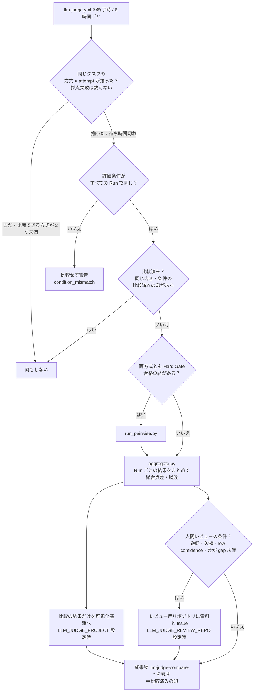

# GitHub Actions

[README に戻る](../README.md)

[ci/llm-judge.yml](../ci/llm-judge.yml)（Run ごと）と [ci/llm-judge-compare.yml](../ci/llm-judge-compare.yml)（タスクごとの方式比較）はテンプレートです（未実行）。評価対象のリポジトリにこのキットを `tools/llm-judge/` として置き、ワークフローを `.github/workflows/` にコピーして使います。評価サービス（[Foundry Hosted Agent](hosted-service.md)）を使う場合は、`llm-judge.yml` が評価データを作ってサービスに登録するだけになり、`llm-judge-compare.yml` は不要です（「[GitHub Actions から使う](hosted-service.md#github-actions-から使う)」）。

## Run ごと（llm-judge.yml）

- 対象リポジトリの CI が Build・Test（Hidden test を含む）・Lint・CodeQL を実行し、その結論が Hard Gate になる
- エージェントの実行基盤が、CI 完了後に `workflow_dispatch` で inputs（Run ID、方式名、base/head、CI の run ID、Skill のディレクトリなど）を渡して起動する。`task_id` は英数字・`_`・`.` だけ（ハイフン不可）、`run_id` は英数字・`_`・`.`・`-` だけを使う（成果物名からタスクを取り出すため）
- ワークフローは共通祖先と head の SHA を固定し、指標と PR 差分で同じコミットを使う。共通祖先がない場合や `metrics.py` が失敗した場合も止めず、指標を計測不能として記録する（Hard Gate 不合格の試行も記録される）。解析結果は `actions/cache` で再利用し、変更されたファイルだけを再計算する
- リポジトリ変数 `LLM_JUDGE_PROJECT`・`LLM_JUDGE_COSMOS_ENDPOINT` とシークレット `APPLICATIONINSIGHTS_CONNECTION_STRING` を設定すると、Hard Gate 不合格の試行も含めて可視化基盤に送る
- CI ワークフローは結果の要約を `ci-summary` という名前の成果物（`ci.txt`）としてアップロードしておく
- OIDC でログインするため、フェデレーション資格情報付きのアプリ登録を作り、Foundry プロジェクトに Azure AI User ロールを付与する。シークレットは `AZURE_CLIENT_ID` / `AZURE_TENANT_ID` / `AZURE_SUBSCRIPTION_ID`
- Run ごとの評価データ・対応表・評価結果を成果物 `llm-judge-run-<task_id>-<run_id>` として保存する。リポジトリ変数 `LLM_JUDGE_COMPARE_VARIANTS` を設定すると、最後に `llm-judge-compare.yml` を起動する

## タスクごとの方式比較（llm-judge-compare.yml）

「方式間の総合点差が小さい」「A/B の順序で判定が逆転」は、同じタスクの複数方式が揃わないと判定できないため、別のワークフローで行います。

- **揃ったかの判定:** `scripts/collect_task.py` が成果物 `llm-judge-run-<task_id>-*` を集め、`LLM_JUDGE_COMPARE_VARIANTS` × `LLM_JUDGE_COMPARE_ATTEMPTS` の Run が揃ったかを見る。Run は「採点済み」（採点結果と `run_meta.json` あり）・「Hard Gate 不合格」・「採点失敗」（合格したが採点結果がない）に分け、前の 2 つだけを「揃った」に数える。採点失敗の Run は `llm-judge.yml` を再実行すれば揃う。同じ Run の再実行は最新の成果物を、同じ方式・attempt に複数の Run があれば最新の Run を使う
- **待ち時間:** 最初の Run から `LLM_JUDGE_COMPARE_TIMEOUT_HOURS`（既定 24 時間）を過ぎたら、揃った分だけで比較し、未提出と採点失敗を `collect.json` に記録する。比較できる方式が 2 つ未満なら比較しない
- **評価条件の照合:** Judge のデプロイとモデルバージョン・評価器のバージョン・ルーブリックのハッシュ・採点回数が異なる Run があれば `condition_mismatch` として比較せず、警告を出す。同じ条件で `llm-judge.yml` を再実行して揃える
- **二重実行の防止:** タスクごとの `concurrency` と、比較済みの印の成果物（`llm-judge-compare-<task_id>-<ハッシュ>`）で、同じ内容を二度比較しない。ハッシュは、比較に使う Run の中身（対応表・評価データ・採点結果）と評価条件、比較側の条件（gap・ペア比較の回数・ペア比較の Judge と評価プロンプト）から作る。Run が増えた、同じ Run を採点し直した、条件を変えた場合はハッシュが変わり、比較し直す。途中で失敗した場合は印を残さず、次の起動でやり直す
- **取りこぼしの拾い直し:** 6 時間ごとに、直近 `LLM_JUDGE_COMPARE_LOOKBACK_DAYS`（既定 14 日）に Run の成果物があり、まだ比較していないタスクを処理する
- **人間レビュー:** `LLM_JUDGE_REVIEW_REPO`（owner/name）と、そのリポジトリに Contents / Issues の書き込み権限を持つ GitHub App（`LLM_JUDGE_REVIEW_APP_ID` とシークレット `LLM_JUDGE_REVIEW_APP_PRIVATE_KEY`）を設定すると、方式名を伏せた資料（`calibration.py export-pairs --flagged` / `export --flagged`）を `reviews/<task_id>/<成果物名>/` に置いて Issue を作る。ペア比較の対応表（`pairs_key.json`）は比較の成果物にだけ残す。レビュー用リポジトリは評価対象とは別の非公開リポジトリにし、レビュアーには評価対象リポジトリの Actions を見せない。埋めたシートは、比較の成果物の `pairwise/` と `pairs_key.json` を使って `publish_results.py --human-pair-reviews` / `--human-reviews` で送る
- **可視化基盤:** Run ごとの結果は `llm-judge.yml` が送り済みなので、`publish_results.py --types comparison,pairwise,pair` で比較の結果だけを送る
- **ジョブの概要:** 状態・揃った Run 数・人間レビューの件数だけを書き、方式名と勝敗は書かない
- タスクをまたいだ方式比較（符号検定の p 値など）は対象外。全成果物を集めて `aggregate.py` / `run_pairwise.py` を実行する
