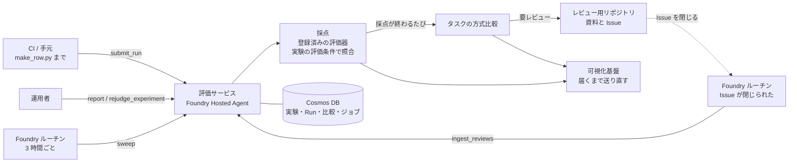

# Foundry Hosted Agent（評価サービス）

[README に戻る](../README.md)

[hosted/](../hosted/) は、[GitHub Actions](github-actions.md) の 2 つのワークフローが行う処理（採点・タスクごとの方式比較・人間レビューの振り分け）を、**実験 ID 単位の評価サービス**として Foundry の Hosted Agent（Invocations プロトコル）に載せたものです。コードとローカルでの動作確認までで、Azure へのデプロイはしていません。



GitHub Actions 版との違いは次のとおりです。

| | GitHub Actions 版 | 評価サービス |
|---|---|---|
| 評価条件 | 届いた結果どうしを照合する（`condition_mismatch`） | **実験の作成時に固定**し、採点の前後で照合する。変わっていれば採点しない |
| 状態 | Actions の成果物 | Cosmos DB（コンテナ `service`、パーティションキー `/experiment_id`） |
| 方式比較 | `llm-judge-compare.yml`（成果物を集める） | 採点が終わるたびに自動で比較する。判定は同じ `collect_task.merge` |
| タスクをまたいだ比較 | 手作業 | `report` 操作（絶対評価・ペア比較の符号検定・人間の判断と Judge の一致） |
| 人間の判断の取り込み | 手作業（`publish_results.py --human-*`） | レビュー用リポジトリの Issue を閉じると、Foundry のルーチンが取り込む |
| モデル更新時の再評価 | 全 Run を手作業でやり直す | 新しい実験を作り、`rejudge_experiment` で同じ Run を採点し直す |
| 呼び出し元 | GitHub Actions のみ | GitHub Actions・Azure DevOps・手元など、同じ API で呼べる |

## 実験と評価条件

`create_experiment` で、比較する方式・生成回数・待ち時間・gap・spread・採点回数と、**その時点の評価条件**（Judge のデプロイとモデルバージョン・評価器のバージョン・ルーブリックのハッシュ）を固定します。ルーブリックのハッシュ（`config.rubric_fingerprint()`）は、評価プロンプト・観点の定義・重み・指標の閾値から作ります。CLI 版の `run_meta.json` にも記録し、`aggregate.py` の照合にも使います。

- 同じ実験の Run は、採点の前（今の条件が実験と同じか）と後（`run_meta.json` が実験と同じか）で照合し、違えば採点しない（Run は「採点失敗」になる）
- 実験の定義は変えられない（同じ定義の作成は既存を返し、違う定義は 409）
- Judge のモデルや評価器を更新したら新しい実験を作り（`base_experiment_id` で元の実験を記録）、`rejudge_experiment` で元の実験の Run を新しい条件で採点し直す。2 つの実験の `report` を比べれば、モデル更新の影響を同じ Run で確かめられる
- 実験 ID はレビュー用リポジトリの Issue に載るため、方式名を含めると作成時に拒否する

## 操作

`POST /invocations` の本文 `{"op": ..., ...}` で呼びます。時間のかかる操作は 202 と `invocation_id` を返すので、`GET /invocations/{invocation_id}` で状態と結果を取得します。入力の仕様は `GET /invocations/docs/openapi.json` で確認できます。

| op | 内容 | 応答 |
|---|---|---|
| `create_experiment` | 実験を作る | 200 |
| `get_experiment` | 定義・評価条件・方式ごとの Run の状態・タスクの比較状態 | 200 |
| `submit_run` | `make_row.py` の対応表の 1 行（`manifest`）と評価データの 1 行（`row`）を登録する。Hard Gate 不合格は記録だけ、合格なら採点を始める。同じ内容の再登録は重複させない | 200 / 202 |
| `compare_task` | タスクの方式比較（`force` で比較済みでもやり直す） | 202 |
| `sweep` | 止まったジョブを失敗として片付け、採点失敗の Run を採点し直し（既定 2 回まで）、全タスクの比較とレビューの取り込みを行う | 202 |
| `ingest_reviews` | レビュー用リポジトリで閉じられた Issue の判断を取り込み、可視化基盤に送る | 202 |
| `rejudge_experiment` | `from_experiment_id` の Run を、この実験の評価条件で採点し直す | 202 |
| `report` | タスクをまたいだ方式比較と、人間の判断の集計 | 200 |
| `review_packets` | レビュー用リポジトリを使わない場合のレビュー資料 | 200 |

[scripts/judge_client.py](../scripts/judge_client.py) から呼べます。

```bash
export LLM_JUDGE_SERVICE_AGENT=llm-judge-service
export AZURE_AI_PROJECT_ENDPOINT=https://<account>.services.ai.azure.com/api/projects/<project>
python scripts/judge_client.py create-experiment --experiment-id exp-2026-11 --project shoplib --variants fixed,hydrafusion
python scripts/judge_client.py submit --experiment-id exp-2026-11 --dataset out/runs.jsonl --manifest out/manifest.jsonl --wait
python scripts/judge_client.py call report --experiment-id exp-2026-11
python scripts/judge_client.py call rejudge_experiment --experiment-id exp-2026-12 --param from_experiment_id=exp-2026-11 --wait
```

## GitHub Actions から使う

[ci/llm-judge.yml](../ci/llm-judge.yml) にリポジトリ変数 `LLM_JUDGE_SERVICE_AGENT`（エージェント名）・`LLM_JUDGE_SERVICE_PROJECT_ENDPOINT` と実験 ID（inputs の `experiment_id` か変数 `LLM_JUDGE_EXPERIMENT_ID`）を設定すると、ワークフローは指標と評価データを作ってサービスに登録し、採点の完了を待つだけになります。採点・可視化基盤への送信・方式比較はサービスが行うので、`llm-judge-compare.yml` は不要です。OIDC のアプリには Foundry プロジェクトの Azure AI User ロールが必要です。

## デプロイ（未実施）

1. [infra/main.bicep](../infra/main.bicep) を再デプロイして Cosmos DB にコンテナ `service` を作る
2. 評価器を登録しておく（`register_evaluators.py`）
3. `hosted/` で azd の環境を作り、変数を設定してデプロイする。デプロイの前に [hosted/sync_kit.py](../hosted/sync_kit.py) が `scripts/` と `evaluators/` をサービスのディレクトリ（`kit/`）にコピーする（azure.yaml の hooks）

   ```bash
   cd hosted
   azd env new llm-judge
   azd env set AZURE_AI_PROJECT_ENDPOINT https://<account>.services.ai.azure.com/api/projects/<project>
   azd env set LLM_JUDGE_STATE_COSMOS_ENDPOINT https://<account>.documents.azure.com:443/
   # 任意: JUDGE_DEPLOYMENT / JUDGE_MODEL_VERSION / LLM_JUDGE_MAX_JOBS / LLM_JUDGE_PUBLISH=1 と LLM_JUDGE_COSMOS_ENDPOINT /
   #       LLM_JUDGE_APPINSIGHTS_CONNECTION_STRING / LLM_JUDGE_REVIEW_REPO と LLM_JUDGE_GITHUB_TOKEN_SECRET_URI
   AZURE_DEV_USER_AGENT=microsoft_foundry_skill azd deploy llm-judge-service
   AZURE_DEV_USER_AGENT=microsoft_foundry_skill azd deploy llm-judge-sweep
   ```

4. エージェントのマネージド ID に権限を付ける: Foundry プロジェクトの **Azure AI User**（Judge のデプロイと評価器の参照・評価の実行）、Cosmos DB の **Built-in Data Contributor**（`dataContributorPrincipalIds` に追加）、レビュー用リポジトリを使うなら Key Vault の **Key Vault Secrets User**
5. 人間レビューをレビュー用リポジトリで受ける場合は、そのリポジトリだけに Contents / Issues の読み書き権限を持つ fine-grained token を Key Vault に置き、`LLM_JUDGE_REVIEW_REPO`・`LLM_JUDGE_GITHUB_TOKEN_SECRET_URI` を設定する。Foundry プロジェクトに GitHub の接続を作り、`LLM_JUDGE_GITHUB_CONNECTION_ID`・`LLM_JUDGE_REVIEW_REPO_OWNER`・`LLM_JUDGE_REVIEW_REPO_NAME` を設定して `azd deploy llm-judge-review-closed` でルーチンを作る

azure.yaml の 2 つのルーチン:

| ルーチン | トリガー | 送る操作 |
|---|---|---|
| `llm-judge-sweep` | 3 時間ごと（Asia/Tokyo） | `{"op": "sweep"}` |
| `llm-judge-review-closed` | レビュー用リポジトリの Issue が閉じられた | `{"op": "ingest_reviews"}` |

## ローカルで動かす

```bash
uv pip install --python .venv/bin/python azure-ai-agentserver-invocations==1.1.0 azure-keyvault-secrets "httpx<1"
LLM_JUDGE_STATE_DIR=/tmp/llm-judge-state PORT=18088 .venv/bin/python hosted/src/llm-judge-service/main.py
LLM_JUDGE_SERVICE_URL=http://localhost:18088 .venv/bin/python scripts/judge_client.py call get_experiment --experiment-id exp1
```

`LLM_JUDGE_STATE_COSMOS_ENDPOINT` がなければ状態はファイル（`LLM_JUDGE_STATE_DIR`）に保存します。ローカルでは `az login` の資格情報（`LLM_JUDGE_AUTH=cli`）で Foundry を呼び、Hosted Agent ではマネージド ID（azure.yaml で `LLM_JUDGE_AUTH=default`）を使います。

## 注意点

- **未検証のこと:** Azure へのデプロイ、ルーチン（プレビューの `azure.ai.routines` 拡張）、GitHub の Issue トリガー、Hosted Agent での時間のかかる処理（1 Run の採点は Judge を 24 回呼ぶ）の挙動は確認していません。ローカルでは、実際の Foundry プロジェクトから評価条件を読み取って実験を作り、Hard Gate 不合格の Run の登録・定期処理・方式比較・レポートまでを HTTP 越しに確認しました（採点は実行していません）
- **中断への備え:** 採点はコンテナ内のスレッドで動かします。セッションのコンピューティングが止まると処理は中断しますが、状態は Cosmos DB にあり、ハートビートの途絶えたジョブ（既定 45 分）は失敗として片付けます。片付けるのは `sweep`（`_service` 配下の `sweep` / `ingest_reviews` を含む全ジョブ）と、同じ操作の重複判定の時点です。止まった `sweep` が後続の `sweep` を止めることはありません。採点失敗の Run は `sweep` が採点し直します
- **採点結果の検証:** Foundry の結果は、試行の数が採点回数と同じで、どの試行にも全項目の行があり、評価器ごとに点数のある結果が 1 つ以上あることを確かめます。満たさなければ採点失敗（ペア比較なら比較の失敗）として採点し直します。一部の試行だけの評価エラーは採点済みとし、従来どおり人間レビューに回します
- **可視化基盤への送信:** 送る内容と送信先を Run・タスク・レビューの文書に保存してから送ります。届かなかった送信先は `publish_status: pending` として残し、同じ Run の再登録時と `sweep` で、その送信先にだけ送り直します
- **実験をまたいだ ID:** 評価サービスが送る文書は、ID に実験 ID を含めます（`publish_results.scope_documents`、CLI では `publish_results.py --experiment-id`）。同じ Run を別の実験で採点し直しても、前の実験の文書を上書きしません。Run の人間レビューの結合キーも `<experiment_id>:<run_id>` にし、Workbook / KQL もこれに合わせています。試行（`LlmJudgeAttempt`）の集計は従来どおり `run_id` で重複を除くので、採点し直した Run を二重に数えません
- **複数のレプリカ:** 同じタスクの比較はプロセス内で直列にしています。複数のコンテナが同時に同じタスクを比較すると、ペア比較が二重に走ることがあります（結果は同じ印で記録されます）
- **文書の大きさ:** Run の評価データ（差分など）と採点結果は 1 つの文書に入れます。Cosmos DB の上限（2 MB）を超えないよう、`make_row.py` の `--max-diff-chars` などで大きさを抑えてください
- **ブラインド:** `get_experiment` と `report` は方式名を含むので、運用者だけが呼ぶようにしてください。レビュー用リポジトリの資料と Issue には方式名を載せません
